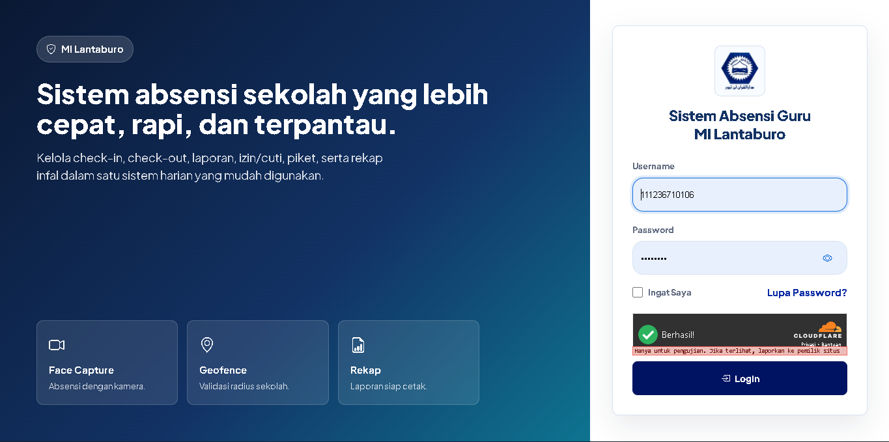
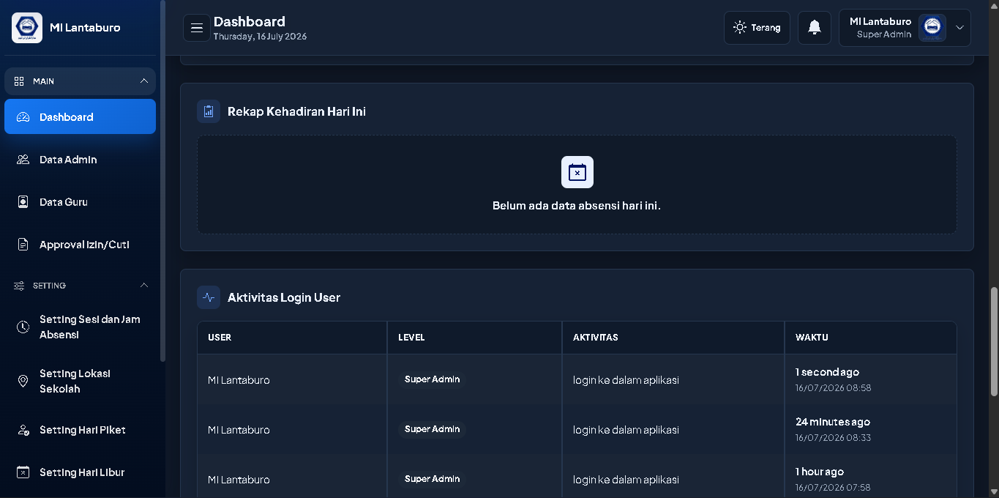
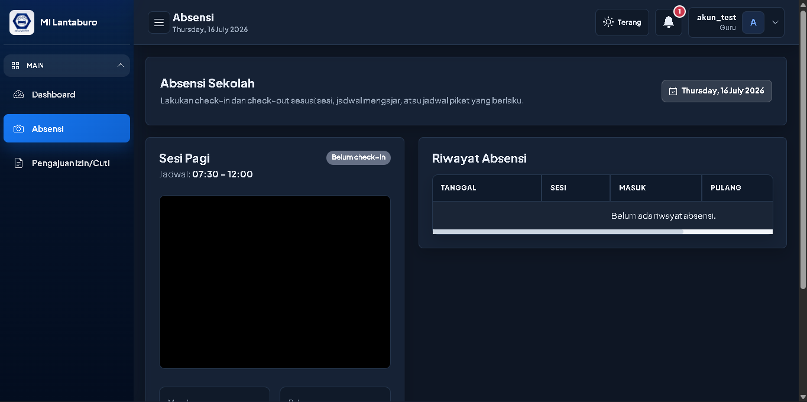
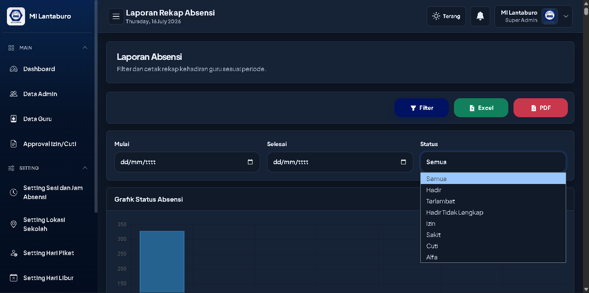
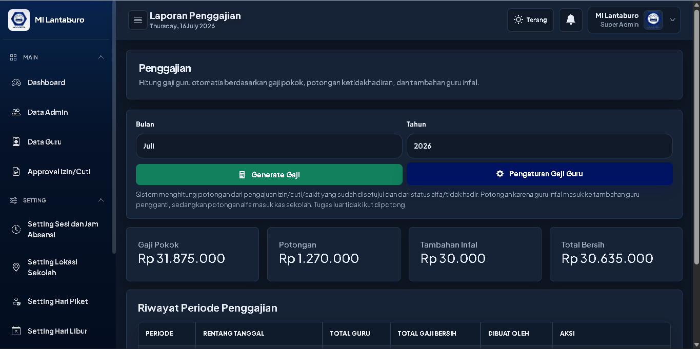

# Sistem Absensi Sekolah

Aplikasi web Laravel untuk mengelola kehadiran guru dan tenaga kependidikan, izin/cuti, jadwal piket, laporan, serta penggajian dalam satu dashboard operasional sekolah.

## Fitur Utama

- **Autentikasi dan hak akses**: login memakai NIP/username untuk guru, tenaga kependidikan, bendahara, kepala sekolah, dan super admin; tersedia reset password, status akun aktif/nonaktif, dan pembatasan percobaan login.
- **Absensi multi-sesi**: check-in/check-out sesuai jadwal kerja dan sesi aktif, validasi geofence, batas akurasi GPS yang dapat diatur, pencatatan keterlambatan, serta pencegahan penyimpanan ganda.
- **Verifikasi wajah 1:1**: enrollment mandiri atau oleh admin, deteksi wajah di browser, dan pencocokan embedding InsightFace melalui service FastAPI internal.
- **Izin dan cuti**: pengajuan izin, sakit, cuti, tugas luar, serta izin sementara dengan approval dan alur guru infal/pengganti.
- **Dashboard dan notifikasi**: ringkasan kehadiran harian, daftar personel yang belum absen, dan notifikasi aktivitas terkait.
- **Laporan**: rekap absensi dan guru infal berdasarkan periode/status, dengan ekspor Excel dan PDF.
- **Penggajian**: perhitungan gaji pokok, potongan ketidakhadiran, tambahan infal, cetak rekap, dan slip gaji.
- **Administrasi sekolah**: pengelolaan pengguna, data guru/karyawan, lokasi sekolah, sesi absensi, hari libur, dan jadwal piket.
- **Operasional dan keamanan**: security headers, konfigurasi CORS/HTTPS, lampiran privat, pembersihan berkala foto absensi dan aktivitas login, tema terang/gelap, serta UI responsif.

## Teknologi

- Laravel 12 dan PHP 8.2+
- MySQL atau MariaDB
- Bootstrap 5, Vite 8, dan Tailwind CSS 4
- FastAPI, InsightFace, ONNX Runtime, dan Docker Compose
- Laravel DomPDF dan Laravel Excel

## Prasyarat

- PHP 8.2+ dan Composer
- MySQL/MariaDB
- Node.js yang kompatibel dengan Vite 8 dan npm
- Docker Desktop/Engine dengan Linux containers untuk service verifikasi wajah
- Browser dengan izin kamera dan geolokasi; HTTPS wajib di lingkungan produksi

## Instalasi Lokal

1. Pasang dependency aplikasi dan frontend:

```bash
composer install
npm install
```

2. Buat konfigurasi lokal:

```bash
cp .env.example .env
php artisan key:generate
```

Sesuaikan `DB_*` pada `.env`. Buat API key acak untuk `FACE_SERVICE_API_KEY`; nilai yang sama dipakai Laravel dan container FastAPI melalui Docker Compose.

3. Siapkan database dan akun super admin pertama:

```bash
php artisan migrate
php artisan admin:create-super
```

Perintah `admin:create-super` meminta NIP, nama, email, dan password secara interaktif. Repository tidak menyediakan akun atau password bawaan.

4. Build aset dan jalankan service:

```bash
npm run build
docker compose up --build -d
php artisan serve
```

Model InsightFace diunduh ke volume Docker saat container `face-api` pertama kali berjalan. Periksa kesiapan service dengan `docker compose ps` dan `docker compose logs -f face-api`.

Untuk pengembangan frontend, gunakan `npm run dev` sebagai pengganti build statis.

## Penjadwalan

Aktifkan Laravel scheduler agar pembersihan foto audit absensi dan aktivitas login berjalan otomatis:

```cron
* * * * * cd /path/to/project && php artisan schedule:run >> /dev/null 2>&1
```

Masa simpan foto dapat diatur lewat `ATTENDANCE_FACE_PHOTO_RETENTION_DAYS`.

## Tangkapan Layar

<details>
<summary>Klik untuk melihat tangkapan layar</summary>

**Login**



**Dashboard**



**Absensi**



**Laporan Rekap Absensi**



**Penggajian**



</details>

## Verifikasi Wajah

Pencocokan wajah dilakukan server-side oleh FastAPI memakai embedding InsightFace. Laravel mengirim foto kamera dan template akun yang sedang login, lalu menyimpan hasil pencocokan serta foto audit pada storage privat.

Fitur ini belum memiliki liveness detection. Foto atau replay layar masih menjadi risiko; jangan gunakan hasil face match sebagai satu-satunya kontrol keamanan untuk kebutuhan berisiko tinggi. Detail setup dan batasan tersedia di [panduan face recognition](docs/face-recognition-guide.md).

## Keamanan Repository

File berisi rahasia atau data nyata tidak disertakan: `.env`, dump database (`*.sql`, `*.sqlite`, `*.db`), arsip lokal, log, cache, foto wajah, foto profil, dan lampiran pengguna. Gunakan `.env.example` sebagai template tanpa mengisinya dengan kredensial produksi.

Sebelum deployment publik, ikuti [checklist security hardening](docs/SECURITY-HARDENING.md). Panduan deployment CloudPanel tersedia di [dokumentasi deployment VPS](docs/vps-cloudpanel-deployment.md).

## Pengujian

```bash
php artisan test
npm run build
cd face-service
python -m pip install -r requirements-dev.txt
python -m pytest tests
```

Image Docker produksi tidak memuat dependency pengujian. Jalankan test FastAPI dari virtual environment Python terpisah agar dependency host tetap terisolasi.

## Lisensi

Dirilis di bawah lisensi [GNU General Public License v3.0](LICENSE). Anda bebas menggunakan, mempelajari, memodifikasi, dan mendistribusikan ulang perangkat lunak ini selama karya turunan tetap dirilis di bawah lisensi yang sama.
